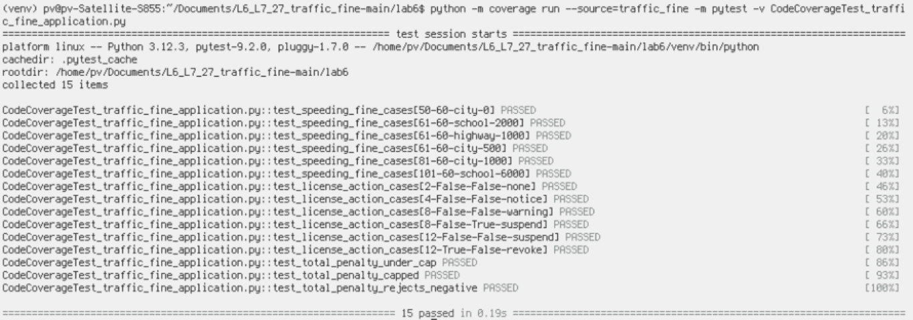
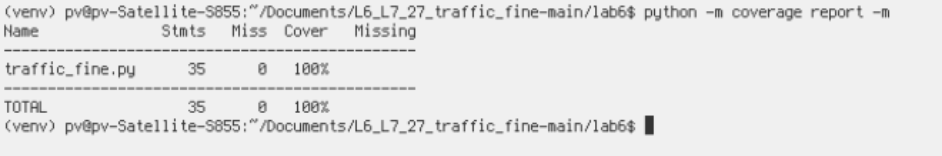
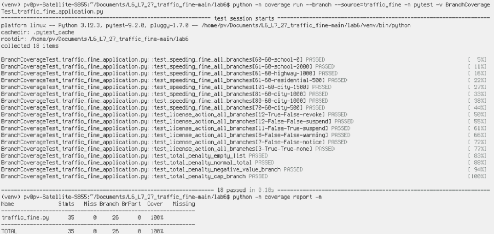

# Lab 6 – Traffic Fine: Coverage Analysis

## Application under test
`traffic_fine.py` contains three functions:
- `speeding_fine(speed, limit, zone)`: selects the fine based on the speed excess and road zone.
- `license_action(points, is_commercial, repeat_offender)`: chooses a licence action from penalty points and offender attributes.
- `total_penalty(fines)`: rejects negative fines and caps the total at 10,000.

## Code coverage result

Commands run from the `lab6` directory with the virtual environment activated:

```bash
python -m coverage erase
python -m coverage run --source=traffic_fine -m pytest -v CodeCoverageTest_traffic_fine_application.py
python -m coverage report -m
```

**Observed result:** 15 tests passed; 100% statement/line coverage (35/35 statements).

### Code coverage terminal evidence

**Pytest execution (15 passed):**



**Coverage report (35 statements, 0 missed, 100%):**



## Branch coverage result

Commands run from the `lab6` directory with the virtual environment activated:

```bash
python -m coverage erase
python -m coverage run --branch --source=traffic_fine -m pytest -v BranchCoverageTest_traffic_fine_application.py
python -m coverage report -m
```

**Observed result:** 18 tests passed; 100% coverage, with 26/26 branches and 0 partial branches.

### Branch coverage terminal evidence



## What the tests exercise
- Speed at/below the limit and above the limit.
- School, highway, and fallback road zones.
- Excess-speed thresholds above 40, above 20, and at/below 20.
- Licence-point thresholds (12, 8, and 4), commercial-driver handling, and repeat-offender handling.
- Empty and non-empty fine lists, negative fine exception, and the 10,000 cap.

## Interpretation
Line coverage confirms every executable statement in `traffic_fine.py` ran at least once. Branch coverage additionally confirms both outcomes of every decision branch ran. The branch suite therefore checks alternate decision outcomes, not just execution of each line.

## Git commit sequence
Run these from the repository root after placing the test files and screenshots in `lab6/`:

**Commit 1 – code coverage**
```bash
git add lab6/CodeCoverageTest_traffic_fine_application.py
git add lab6/coverage_screenshots/code_coverage_tests.png
git add lab6/coverage_screenshots/code_coverage_report.png
git commit -m "Add traffic fine code coverage tests"
```

**Commit 2 – branch coverage**
```bash
git add lab6/BranchCoverageTest_traffic_fine_application.py
git add lab6/coverage_screenshots/branch_coverage_terminal.png
git add lab6/coverage_analysis.md
git commit -m "Add traffic fine branch coverage tests"
git push
```

The commits are not created or pushed by this package. Run the commands in your own authenticated clone so the commits appear in your assigned GitHub repository.
